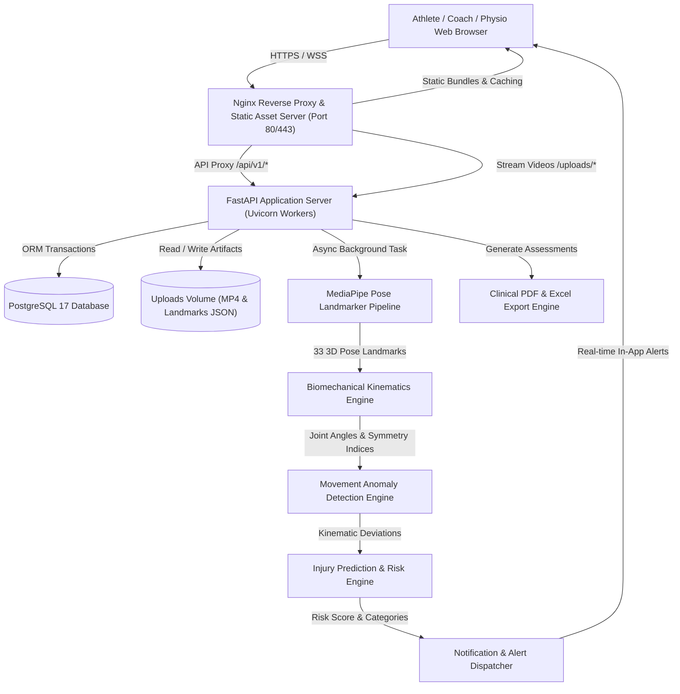

# AthletiQ Architecture & System Integration

## 1. High-Level System Overview

AthletiQ is an end-to-end AI platform for athlete movement screening, biomechanical kinematics evaluation, dynamic anomaly detection, and injury-risk assessment.

The system connects a high-performance modern web application with a computer vision pipeline, clinical biomechanical kinematics calculations, and structured reporting.

---

## 2. Component Integration

### 2.1 Frontend Client (React 19 + Vite + Tailwind CSS)
- **Modular Routing**: Code-split routes loaded on demand using `React.lazy` and `Suspense` for maximum initial page-load performance.
- **State Management & Authentication**: `AuthContext` seamlessly manages user state with automatic token renewal and immediate logout on session expiry.
- **Visual Analytics**: Interactive kinematic angle curves, risk distribution badges, and anomaly timelines rendered with Recharts and Framer Motion.
- **Error Resilience**: Root `<ErrorBoundary>` intercepts unexpected runtime rendering faults and provides instant recovery actions.

### 2.2 Reverse Proxy & API Gateway (Nginx)
- **Unified Origin**: Serves the single-page application while proxying `/api/` and `/uploads/` to the FastAPI backend, eliminating cross-origin complications in production.
- **Streaming Support**: Supports HTTP Byte-Range requests for low-latency playback and scrubbing of uploaded and annotated MP4 video trials.
- **Security Hardening**: Enforces `X-Frame-Options`, `X-Content-Type-Options: nosniff`, `X-XSS-Protection`, and Gzip compression.

### 2.3 Backend API Service (FastAPI + Python 3.11)
- **Asynchronous Task Queue**: Video uploads are acknowledged immediately (`200 OK`) while MediaPipe pose estimation and biomechanical analysis execute asynchronously in background tasks.
- **Request Correlation & Timing**: Every HTTP request receives a unique `X-Request-ID` and `X-Process-Time` response header, logged consistently across all backend loggers.
- **GZip Response Compression**: Payloads larger than 1KB (such as high-frequency 3D landmark arrays) are compressed on the fly, reducing network transfer sizes by ~80%.

### 2.4 Biomechanical Analysis & ML Pipeline
1. **Video Ingestion & Metadata Extraction**: OpenCV decodes video dimensions, frame count, FPS, and verifies header integrity.
2. **Pose Estimation**: MediaPipe BlazePose extracts 33 standard body landmarks with 3D normalized coordinates $(X, Y, Z)$ and confidence scores.
3. **Kinematic Computation**:
   - Dynamic Knee Valgus angle (medial knee collapse angle)
   - Trunk Lateral Lean & Forward Flexion
   - Bilateral Hip & Knee Extension Symmetry Index
   - Ground reaction absorption kinematics
4. **Anomaly Classification**: Kinematic telemetry is benchmarked against normative athletic movement ranges (e.g., FIFA Medical Network, American College of Sports Medicine thresholds).
5. **Injury Prediction**: Weighted multi-factor risk scoring computes total vulnerability score (0–100%) and categorizes risk into Low, Moderate, or High.
6. **Corrective Drills**: Synthesizes targeted neuromuscular drills, strengthening protocols, and mobility exercises.

### 2.5 Notification & Alert Dispatcher
- Dispatches in-app alerts with severity tags (`critical`, `warning`, `info`) for:
  - Severe Dynamic Knee Valgus ($> 15^\circ$)
  - Extreme Trunk Flexion / Spinal Shear
  - Elevated Acute-to-Chronic Workload Ratio (ACWR $> 1.5$)
- Alerts notify both the individual athlete and all coaching/physiotherapy staff assigned to the athlete.

### 2.6 Clinical Report & Export Engine
- **Structured JSON**: Detailed nested analytics for interactive UI widgets.
- **Clinical PDF Reports**: Print-ready multi-page clinical documents with athlete biometrics, risk badges, kinematic metrics, and doctor sign-off sections using ReportLab.
- **Clinical Excel Reports**: Formatted multi-tab workbooks with automated color-coded risk flags using OpenPyXL.
